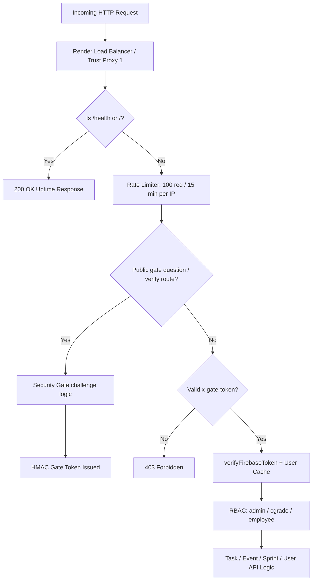
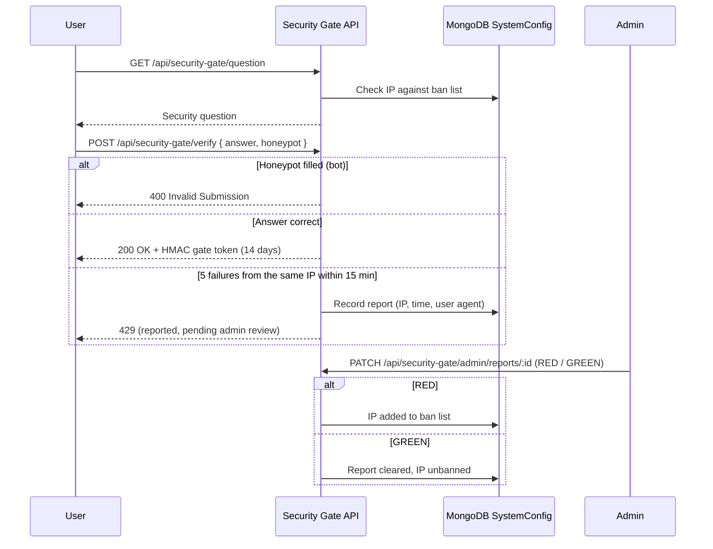
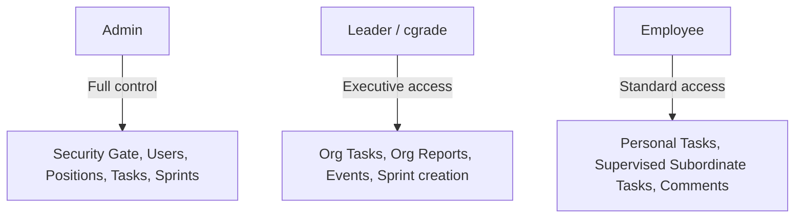

# KanbaKan — Security & Application Features Report

This report describes the security architecture, core features, and Role-Based Access Control (RBAC) model implemented in **KanbaKan**.

---

## 1. Executive Summary

**KanbaKan** is a kanban task management system designed for teams of roughly 20 to 30 people. It is built with Express.js, MongoDB (Mongoose), Firebase Authentication / Cloud Messaging, and Vite + React + TypeScript. It combines sprint planning, deadline alerts, organizational hierarchy tracking, user positions, and layered security controls. It is MIT licensed and designed to run on free-tier hosting (Vercel, Render, MongoDB Atlas, Firebase).

> [!NOTE]
> Free-tier limits and the keep-alive setup depend on third-party services and can change. Check current provider limits before relying on them.

---

## 2. Security Architecture

KanbaKan uses layered controls: network protection, a bot/intrusion gate, token authentication, role-based authorization, and data integrity safeguards.

### A. Network & Request Protection

* **Reverse proxy trust (`app.set('trust proxy', 1)`)**
  * Trusts the Render load balancer so the real client IP is read from `x-forwarded-for`.
  * Prevents all users from being counted as one IP by the rate limiter.
* **Health check exemption**
  * `/health` and `/` are registered **before** the rate limiter.
  * External keep-alive pings (e.g., `cron-job.org`) do not consume API quota or trigger `429` responses.
* **Helmet security headers (set by the Express API)**
  * Content Security Policy restricting script/connect sources to Firebase, Google APIs, Vercel, and Render origins.
  * Frameguard (`deny`) against clickjacking.
  * `noSniff` against MIME sniffing.
  * Referrer policy `strict-origin-when-cross-origin`.
  * These headers apply to API responses. The Vercel-hosted frontend needs its own header configuration if the same protections are wanted there.
* **CORS origin allowlist**
  * Allows local development origins (`localhost:5173`, `localhost:5174`) and Vercel origins matching `*.vercel.app`.
  * Explicit `OPTIONS` preflight handler with `Access-Control-Max-Age: 86400`.
  * CORS controls which browser origins may call the API. It is not an authorization mechanism; authentication and RBAC handle that.
* **Rate limiting (`express-rate-limit`)**
  * General API limiter: 100 requests / 15 minutes per IP.
  * Reporting limiter: 20 requests / 15 minutes on the report-data endpoints. (PDF files themselves are generated in the browser; the limiter protects the backend data requests.)

### B. Authentication & Token Security

* **Firebase Admin authentication**
  * Protected `/api/*` routes require `Authorization: Bearer <id_token>`, verified with the Firebase Admin SDK.
* **Security-gate token requirement**
  * Application API routes additionally require a valid `x-gate-token`. The public gate question/verify routes and health endpoints are exempt.
* **Server-side user cache**
  * In-memory cache (5-minute TTL, `USER_CACHE_TTL`) maps Firebase `uid` to MongoDB `_id` and `role`.
  * The cache entry is cleared on account deletion via `clearUserCache(uid)`.

### C. Security Gate (Bot & Intrusion Shield)

The gate is a challenge screen shown before login/registration, backed by API-level token enforcement.

1. **Honeypot trap**
   * Hidden field `company_website_url`. Bots that autofill it are rejected with `400 Invalid Submission`.
2. **Salted PBKDF2 answer hashes**
   * Answers are normalized and stored as individual salted PBKDF2-SHA512 hashes (`hashAnswersList`).
   * Legacy plaintext answers are converted to hashes and removed from configuration storage.
   * Admin responses never return answers or hashes. Admins can replace answers but cannot retrieve existing ones.
3. **HMAC-signed gate tokens (`x-gate-token`)**
   * HMAC-SHA256 signed, valid for **14 days (1,209,600 seconds)**.
   * The token and `securityGatePassed` flag are persisted to `localStorage`, so users do not re-solve the challenge on every visit.
   * Application API routes verify the token with `verifyGateTokenHeader`.
   * Gate-token expiry no longer signs out already-authenticated users. Unauthenticated users are returned to the challenge after expiry.
   * Trade-off: a longer token lifetime improves usability but widens the window in which a stolen token is usable.
4. **Failure threshold and admin report queue**
   * Five failed attempts from one IP within 15 minutes create a report (IP, timestamp, user agent).
   * Further incorrect answers return `429` and are marked pending review.
   * The IP is **blocked only after an admin chooses RED**. A flagged IP is not automatically banned.
5. **Admin panel and RED/GREEN workflow**
   * **RED**: adds the IP to the ban list.
   * **GREEN**: clears the report and restores access.
   * Admins can change the security question and accepted answers from the dashboard.

### D. Permanent Admin Protection

A single designated **Permanent Admin** account is protected against lockout and takeover:

* `isPermanentAdmin()` guards the **role-change, warning, delete, and email-update** routes. These actions are rejected for this account.
* The account is **auto-healed to the `admin` role** on server startup and whenever users are listed.
* The frontend shows a **"Permanent Admin"** badge and disables all destructive actions for that account.
* The account's email is set in backend configuration and is intentionally not listed in this report.

### E. Data Integrity & Concurrency

* **Optimistic concurrency control**
  * Task updates match on `updatedAt` (`Task.findOneAndUpdate({ _id, updatedAt })`). Concurrent edits return `409 Conflict` instead of silently overwriting.
* **Soft deletes**
  * Tasks are marked `isDeleted: true` rather than removed, preserving audit logs and activity history.
* **Notification de-duplication**
  * `firebase-messaging-sw.js` checks `!payload.notification` before calling `showNotification()` to avoid duplicate pop-ups on mobile.

---

## 3. Application Features

| Feature Module | Key Capabilities |
| :--- | :--- |
| **Kanban Task Board** | Columns (Todo, In Progress, Review, Completed), priorities (Low, Medium, High, Urgent), link attachments, due dates, tags, optional sprint number. |
| **Personal Dashboard** | Tasks assigned to the logged-in user, filterable by status and priority. |
| **Organization Dashboard** | Organization-wide board for Admin and Leader roles. For Employees, the backend always scopes results to the employee and their reporting hierarchy. `supervisedOnly=true` narrows managers to their chain of command. |
| **Sprint Management & Planning Hub** | Create sprints, activate and close sprints, view velocity, assign tasks to sprints. Update/archive is Admin only (see RBAC). |
| **Sprint Field on Tasks** | Optional `sprint` number on each task. Shown on task cards, task detail modals, and the calendar, and included in CSV/PDF report exports. |
| **User Positions** | Admin-assigned position per user: Intern, Superior Intern, Leader, Admin, CTO, COO, CEO. Admins can add custom positions via "Add New". Options are stored in `SystemConfig` (`key: 'positionOptions'`). A position badge appears beside user names across the header, boards, COC tree, calendars, comments, dropdowns, reports, and settings. |
| **Chain of Command (COC) Tree** | Interactive org chart of direct and nested subordinates. Nodes show **color-coded position badges** (not role badges). |
| **Deadlines & Calendar** | Monthly/weekly calendar of task due dates and events. |
| **Automated Deadline Alerts** | `node-cron` job runs **daily at 08:00** and sends push notifications to assignees of tasks **due the next day**. |
| **Activity Log & Comments** | Audit trail of status changes, reassignments, comments, and timestamps. |
| **Reporting & Analytics Hub** | CSV and PDF exports (PDFs generated in-browser with jsPDF). Employees get personal reports; Leaders and Admins also get organization reports. Report-data endpoints are rate limited. |
| **Push Notifications (FCM)** | Task assignments, reassignments, deadline warnings, and security alerts, with single-notification handling on mobile. |
| **Profile & Settings** | Username, superior selection, light/dark theme, self account deletion (purges Firebase Auth and Mongo user). |
| **PWA & Mobile Install** | Service worker registration and a custom install banner (`InstallPWA`). |

### Position System API

| Route | Purpose | Access |
| :--- | :--- | :---: |
| `PATCH /api/users/:id/position` | Assign a position to a user | Admin |
| `GET /api/users/position-options` | List available positions | Authenticated |
| `POST /api/users/position-options` | Add a custom position option | Admin |

---

## 4. Role-Based Access Control

### Roles and naming

The backend `role` enum is `['admin', 'cgrade', 'employee']`. The frontend displays **Leader** for `cgrade`.

| Backend value | UI label | Description |
| :--- | :--- | :--- |
| `admin` | Admin | Full system control |
| `cgrade` | Leader | Executive management, org-wide visibility |
| `employee` | Employee | Standard user, hierarchy-scoped visibility |

In addition, one **Permanent Admin** account exists with extra protections (see Section 2D).

> [!NOTE]
> **Position is separate from role.** Position (Intern, CTO, etc.) is a stored title shown in the UI. Access control is determined by the `role` field.

### Permissions matrix

| Capability / Action | Guest | Employee | Leader (`cgrade`) | Admin |
| :--- | :---: | :---: | :---: | :---: |
| **View Security Gate Question** | `ALLOWED` | `ALLOWED` | `ALLOWED` | `ALLOWED` |
| **Submit Security Gate Challenge** | `ALLOWED` | `ALLOWED` | `ALLOWED` | `ALLOWED` |
| **View Health Check (`/health`)** | `ALLOWED` | `ALLOWED` | `ALLOWED` | `ALLOWED` |
| **Log In via Firebase Auth** | `ALLOWED` | `ALLOWED` | `ALLOWED` | `ALLOWED` |
| **View Own Personal Tasks** | `DENIED` | `ALLOWED` | `ALLOWED` | `ALLOWED` |
| **Create New Task** | `DENIED` | `ALLOWED` | `ALLOWED` | `ALLOWED` |
| **Edit Task Created By Self** | `DENIED` | `ALLOWED` | `ALLOWED` | `ALLOWED` |
| **Edit Task Assigned To Self** | `DENIED` | `ALLOWED` | `ALLOWED` | `ALLOWED` |
| **Edit Task Created By/Assigned to Subordinates** | `DENIED` | `ALLOWED` | `ALLOWED` | `ALLOWED` |
| **Edit Unrelated Task (Outside Hierarchy)** | `DENIED` | `DENIED` | `ALLOWED` | `ALLOWED` |
| **Update Task Status (Owner / Assignee)** | `DENIED` | `ALLOWED` | `ALLOWED` | `ALLOWED` |
| **Reassign Task to Different User** | `DENIED` | `DENIED` | `DENIED` | `ALLOWED` |
| **Soft-Delete Task** | `DENIED` | `ALLOWED` (Own/Sub) | `ALLOWED` | `ALLOWED` |
| **Add Comment / View Activity History** | `DENIED` | `ALLOWED` | `ALLOWED` | `ALLOWED` |
| **View Supervised Tasks (`supervisedOnly=true`)** | `DENIED` | `ALLOWED` (Subordinates) | `ALLOWED` (All) | `ALLOWED` (All) |
| **View Chain of Command (COC) Tree** | `DENIED` | `ALLOWED` | `ALLOWED` | `ALLOWED` |
| **Create & Manage Events / Calendar** | `DENIED` | `ALLOWED` | `ALLOWED` | `ALLOWED` |
| **Create Sprints** | `DENIED` | `ALLOWED` | `ALLOWED` | `ALLOWED` |
| **Update or Archive Sprints** | `DENIED` | `DENIED` | `DENIED` | `ALLOWED` |
| **Export Personal CSV/PDF Reports** | `DENIED` | `ALLOWED` | `ALLOWED` | `ALLOWED` |
| **View / Export Organization Reports (`GET /api/reports/org`)** | `DENIED` | `DENIED` | `ALLOWED` | `ALLOWED` |
| **Update Own Profile (Name, Username, Superior)** | `DENIED` | `ALLOWED` | `ALLOWED` | `ALLOWED` |
| **Register FCM Device Token** | `DENIED` | `ALLOWED` | `ALLOWED` | `ALLOWED` |
| **Delete Own Account** | `DENIED` | `ALLOWED` | `ALLOWED` | `ALLOWED` |
| **List All Registered Users** | `DENIED` | `ALLOWED` | `ALLOWED` | `ALLOWED` |
| **Change User Role (Promote/Demote)** | `DENIED` | `DENIED` | `DENIED` | `ALLOWED` |
| **Issue Official Warning to User (`isWarned`)** | `DENIED` | `DENIED` | `DENIED` | `ALLOWED` |
| **Assign/Update User Superior** | `DENIED` | `DENIED` | `DENIED` | `ALLOWED` |
| **Assign User Position** | `DENIED` | `DENIED` | `DENIED` | `ALLOWED` |
| **Add New Position Option** | `DENIED` | `DENIED` | `DENIED` | `ALLOWED` |
| **Delete Any User Account** | `DENIED` | `DENIED` | `DENIED` | `ALLOWED` |
| **Modify Permanent Admin (role / warn / delete / email)** | `DENIED` | `DENIED` | `DENIED` | `DENIED` |
| **Access Admin Security Gate Config** | `DENIED` | `DENIED` | `DENIED` | `ALLOWED` |
| **Update Security Question & Answers** | `DENIED` | `DENIED` | `DENIED` | `ALLOWED` |
| **View IP Intrusion Reports & Ban List** | `DENIED` | `DENIED` | `DENIED` | `ALLOWED` |
| **Review IPs (RED/GREEN Decisions)** | `DENIED` | `DENIED` | `DENIED` | `ALLOWED` |

---

## 5. Summary of Recent Improvements

1. **Keep-alive and health check**: `/health` placed before rate limiters with `trust proxy: 1`, so Render keep-alive pings stay clean.
2. **Push notification de-duplication**: fixed duplicate pop-ups on mobile via the FCM service worker.
3. **Security gate review workflow**: persistent IP tracking, 5-attempt threshold, RED/GREEN admin decisions.
4. **Gate hardening**: salted PBKDF2 answer hashes, plaintext answers removed, gate token enforced on application API routes, 14-day persisted tokens, no sign-out of authenticated users on gate expiry.
5. **Hierarchy-aware delegation**: recursive subordinate lookup (`getAllSubordinateIds`) so managers can see and manage their chain of command, with backend scoping for Employees.
6. **User position system**: admin-assigned positions with custom options and badges across the UI and COC tree.
7. **Sprint number on tasks**: shown in the UI and included in report exports.
8. **Report access split**: personal reports for everyone; organization reports for Leader and Admin only.
9. **Permanent Admin protection**: guarded routes, auto-healing, and UI safeguards.
